# Unify Data Platform

Data engineering on Databricks with a medallion architecture (bronze, silver, gold)
on managed Iceberg tables in Unity Catalog. It has two use cases: a streaming
ingestion path for market data and a batch analytics path for card transactions.
Both run on Databricks Free Edition with serverless compute, and both were
verified against a live workspace.



## Use cases

| Use case | Flow | Highlights |
|---|---|---|
| [CardPulse](cardpulse/README.md): card transaction analytics | CSV → UC Volume → bronze → silver + rejected → gold, with a per-run audit | Masks card numbers, records a reject reason for every bad row, checks that bronze = silver + rejected on every run, skips files that already loaded |
| [SPY market bars](spy_bars/README.md): market data ingestion | MongoDB → Kafka → JSON Lines → UC Volume → Auto Loader bronze → silver + quarantine | Resumable producer checkpoints, Kafka offsets committed after files are durable, idempotent uploads, Auto Loader with an explicit schema |

SPY bars streaming flow, from the local Kafka pipeline to Databricks:



## What this shows

- **Medallion layering:** raw data kept as-is in bronze, validated and conformed data in
  silver, business aggregates in gold. Bad rows go to a rejected or quarantine table
  with the reasons, rather than being dropped.
- **Open table format:** tables are managed Iceberg (`USING ICEBERG`) under Unity Catalog.
  This was confirmed with `information_schema` and `DESCRIBE DETAIL` for all CardPulse
  tables and for SPY bronze.
- **Data quality and reconciliation:** each CardPulse run writes rows read, loaded and
  rejected to `pipeline_run_audit`. A run fails unless every bronze row lands in exactly
  one silver table.
- **Reliability:** checkpoints and committed offsets let the streaming path restart
  safely, uploads are idempotent, and the batch path guards against loading a file twice.
- **Deployment as code:** CardPulse deploys a serverless job with a Databricks Asset Bundle
  (`databricks.yml`). DDL lives in `.sql` files, separate from PySpark code.
- **Data governance:** no credentials in git, card numbers masked after bronze, all
  storage in Unity Catalog Volumes and tables.

## Verified results

| Use case | Check | Result |
|---|---|---|
| CardPulse | Bronze = silver + rejected | 1,000 = 974 + 26, run `SUCCEEDED` |
| CardPulse | Table format | All 5 tables `ICEBERG`, `MANAGED` |
| CardPulse | Rerun of the same file | Skipped, no new rows |
| SPY bars | Upload rerun | Remote SHA-256 matched every file, no files uploaded twice |
| SPY bars | Auto Loader rerun | Each file's bronze count matched its landed line count |

## Tech stack

Databricks Free Edition (serverless jobs, SQL warehouse), Unity Catalog, Apache Iceberg,
PySpark, Auto Loader, Databricks Asset Bundles and CLI, Databricks SDK for Python,
Kafka, MongoDB, Python 3.11, pytest.

## Repository layout

```
cardpulse/      batch medallion pipeline: sql/, notebooks/, sample_data/, databricks.yml
spy_bars/       streaming ingestion: producer, Kafka file writer, uploader, notebooks, tests
```

Each use case is a self-contained directory with its own README covering setup,
how to run it, how to verify it, and its known limits.

## Running a use case

- **CardPulse:** generate or reuse the sample CSV, upload it to the landing Volume, then
  `databricks bundle deploy` and `databricks bundle run cardpulse_batch_pipeline`.
  Full steps are in [cardpulse/README.md](cardpulse/README.md).
- **SPY bars:** needs local MongoDB and Kafka. The step-by-step guide is in
  [spy_bars/README.md](spy_bars/README.md).
