# CardPulse: batch medallion pipeline

Credit card analytics on Databricks Free Edition. One daily transactions CSV moves
through bronze, silver and gold Iceberg tables in Unity Catalog under `workspace.cardpulse`.
Every run is recorded in `pipeline_run_audit`.

How one run moves rows through the tables:



| Table | What it holds |
|---|---|
| `bronze_card_transactions` | CSV rows as-is (all STRING) + `source_file`, `load_ts`, `run_id` |
| `silver_card_transactions` | Valid, deduplicated rows. Card masked to last 4 digits, timestamps in UTC |
| `silver_rejected_transactions` | Every other bronze row, with `reject_reason` |
| `gold_daily_spend_by_category` | Count, total and average spend per day and category |
| `pipeline_run_audit` | `rows_read`, `rows_loaded`, `rows_rejected`, `status` per run |

DDL lives in `sql/`. PySpark code lives in `notebooks/`. `run_pipeline.py` is the only
notebook. The other files are plain Python modules that it imports.

## Reject rules

A row can fail several rules at once. Every failed rule is listed, separated by `;`.

| `reject_reason` | Rule |
|---|---|
| `missing_transaction_id` | `transaction_id` is empty |
| `missing_card_number` | `card_number` is empty |
| `invalid_card_number` | `card_number` is not 16 digits |
| `missing_merchant_category` | `merchant_category` is empty |
| `invalid_amount` | `amount` is empty or not a number |
| `negative_amount` | `amount` < 0 |
| `invalid_transaction_ts` | The timestamp matches neither `yyyy-MM-dd'T'HH:mm:ssX` nor `MM/dd/yyyy HH:mm:ss` (read as UTC) |
| `duplicate_transaction_id` | A valid row whose `transaction_id` already appeared earlier in the run. The first copy is kept |

## How to run

1. **Generate the CSV** (optional, because the file is already committed):
   ```bash
   python cardpulse/generate_transactions.py
   ```
   This writes `sample_data/card_transactions_2026-11-14.csv` with 1,000 rows. It plants
   10 duplicates, 8 negative amounts, 6 empty card numbers and 2 unparseable timestamps.
   The seed is fixed, so you always get the same file. Expected result: 974 silver rows
   and 26 rejected rows.

2. **Create the schema and Volume.** In the Databricks SQL editor, run `sql/00_create_schema.sql`.

3. **Upload the CSV.** In Catalog Explorer, open `workspace` → `cardpulse` → `landing`,
   click **Upload to this volume**, and choose the CSV. You can also use the Databricks CLI:
   ```bash
   databricks fs cp cardpulse/sample_data/card_transactions_2026-11-14.csv \
     dbfs:/Volumes/workspace/cardpulse/landing/
   ```

4. **Deploy and run the job** with the Databricks Asset Bundle in `databricks.yml`.
   Run these from `cardpulse/`, with `DATABRICKS_HOST` and `DATABRICKS_TOKEN` set or a CLI profile configured:
   ```bash
   databricks bundle validate
   databricks bundle deploy
   databricks bundle run cardpulse_batch_pipeline --params source_file=card_transactions_2026-11-14.csv
   ```
   The deploy uploads `notebooks/` and `sql/` together and creates a serverless job.
   In the `dev` target the job is named `[dev <you>] cardpulse-batch-pipeline`.
   The notebook creates any missing tables from `sql/*.sql`, then runs bronze, silver,
   gold and the audit write.

   Without the CLI, you can instead add this repo to the workspace as a Git folder,
   open `cardpulse/notebooks/run_pipeline.py` on serverless compute, set the
   `source_file` widget, and click **Run all**.

To load a new day, upload the new CSV and run the job again with the new file name.
If a file already has a `SUCCEEDED` audit row, the job skips it rather than load it twice.

## Check that bronze = silver + rejected

The pipeline checks this itself. If the counts don't match, it marks the run `FAILED` and
raises an error. To see the result per run:

```sql
SELECT run_id, source_file, rows_read, rows_loaded, rows_rejected,
       rows_read = rows_loaded + rows_rejected AS counts_match, status, error_message
FROM workspace.cardpulse.pipeline_run_audit
ORDER BY started_ts DESC;
```

To check the tables directly, without relying on the audit row:

```sql
WITH bronze AS (
  SELECT run_id, count(*) AS bronze_rows FROM workspace.cardpulse.bronze_card_transactions GROUP BY run_id
), silver AS (
  SELECT run_id, count(*) AS silver_rows FROM workspace.cardpulse.silver_card_transactions GROUP BY run_id
), rejected AS (
  SELECT run_id, count(*) AS rejected_rows FROM workspace.cardpulse.silver_rejected_transactions GROUP BY run_id
)
SELECT bronze.run_id, bronze_rows,
       coalesce(silver_rows, 0) AS silver_rows,
       coalesce(rejected_rows, 0) AS rejected_rows,
       bronze_rows = coalesce(silver_rows, 0) + coalesce(rejected_rows, 0) AS counts_match
FROM bronze
LEFT JOIN silver USING (run_id)
LEFT JOIN rejected USING (run_id);
```

For the sample file you should see 1000 = 974 + 26. To see why rows were rejected:

```sql
SELECT reject_reason, count(*) FROM workspace.cardpulse.silver_rejected_transactions
GROUP BY reject_reason ORDER BY reject_reason;
```

## Verified on Databricks Free Edition (2026-11-15)

- `information_schema.tables` lists all five tables as `ICEBERG`, `MANAGED`.
- The audit row for the sample file shows `rows_read=1000`, `rows_loaded=974`,
  `rows_rejected=26`, `SUCCEEDED`. The direct count query also matched (`counts_match = true`).
- Reject reasons: 10 `duplicate_transaction_id`, 8 `negative_amount`,
  6 `missing_card_number`, 2 `invalid_transaction_ts`.
- Gold has 8 rows, one per category, for 2026-11-14.
- Silver and rejected contain no unmasked card numbers.
- Running the job a second time on the same file skipped it. Bronze stayed at 1,000 rows,
  and the audit table still had a single row.

## Limits

- Bronze keeps the full card number because it stores the file as-is. That is only
  acceptable because the data is fake. Silver and rejected store the masked value only.
- If a run fails partway, its rows stay in the tables that were already written, tagged with
  that run's `run_id`. A rerun gets a new `run_id`, so the per-run counts stay correct, but
  bronze will hold the file twice. Delete the failed run's rows by `run_id` if you want them gone.
- Deduplication is within a run only. The same `transaction_id` arriving in a later file
  is not detected.
