# SPY market bars pipeline

Python 3.11+. Reads only `unified_trader.bars_1m` for SPY from MongoDB,
ordered by `ts`. Creates the Kafka topic if absent and emits JSON with the
symbol as the message key. `_id` is a string and `ts` is an ISO UTC timestamp.

This use case replays SPY one-minute market bars from MongoDB through Kafka
and JSON Lines files into Databricks bronze, silver, and quarantine tables.
Run all commands below from this `spy_bars/` directory.

How one bar travels from MongoDB to silver, and where each step saves its position:



## Start

```sh
cd /path/to/unify-data-platform/spy_bars
python3 -m venv ../.venv
../.venv/bin/pip install -r requirements.txt
# Only on a fresh setup (keep your existing .env):
cp -n .env.example .env
../.venv/bin/python replay.py
```

MongoDB must listen at localhost:27017; Kafka must listen at localhost:9092.
Both were already running during setup. Python packages were installed only
in `.venv`. Configure the interval, batch size, start date, topic, broker,
Mongo URI and checkpoint path in `.env`; exported variables take precedence.
Start dates are inclusive and interpreted as UTC. The saved checkpoint is an
additional exclusive lower bound. Use a separate state file for another topic.

The first batch sends immediately; subsequent batches wait the configured
interval after the previous batch completes. The producer exits at end of input.
Ctrl+C finishes any in-flight delivery and checkpoint, then flushes Kafka.

## Watch in another terminal

```sh
kafka-console-consumer --bootstrap-server localhost:9092 --topic udp.spy_bars_1m --from-beginning --property print.key=true --property key.separator=' | '
```

## Prove restart

1. Run the producer until a `Batch sent` line appears, then press Ctrl+C.
2. Run `cat .state/spy-bars.json` and note `ts`.
3. Restart `../.venv/bin/python replay.py`. The first logged timestamp must be
   later than the saved timestamp. Press Ctrl+C again when finished.

Checkpoints are saved atomically after each broker acknowledgment. A process
crash between acknowledgment and checkpoint can produce a duplicate (at-least-once
delivery). Only one producer may hold a given checkpoint lock. Timestamp-based
resume assumes unique, immutable SPY timestamps and no later inserts before the
checkpoint. MongoDB is accessed only with read operations; credentials granting
read-only access can be supplied through MONGO_URI.

Environment files, virtual environments and state are ignored by git. Do not
store market data or credentials in tracked files. The live verification sent
the first two source bars and retained the checkpoint for normal continuation.

## Step 2: Kafka to local JSON Lines

Start the consumer in its own terminal:

```sh
cd /path/to/unify-data-platform/spy_bars
../.venv/bin/python file_writer.py
```

Run `../.venv/bin/python replay.py` in another terminal. Watch completed files:

```sh
while true; do
  find landing/spy_bars_1m -name '*.jsonl' -exec wc -l {} +
  sleep 2
done
```

The fixed consumer group is `udp-spy-bars-file-writer`. A new group starts at
Kafka's earliest retained offset; restarts use committed offsets. `.env` settings:

- `FILE_WRITER_BATCH_SIZE=10`
- `FILE_WRITER_INTERVAL_SECONDS=30` (measured from the first buffered bar)
- `FILE_WRITER_DIRECTORY=landing/spy_bars_1m`

The writer also uses `KAFKA_BOOTSTRAP_SERVERS` and `KAFKA_TOPIC`. Each filename
contains the first and last timestamps in consumption order plus a unique suffix
so duplicate deliveries cannot overwrite existing files. Only `.jsonl` files
are complete; a hard crash can leave ignored `.pending` files. The writer syncs
file contents, renames in the same directory, syncs the directory, then commits
explicit Kafka offsets synchronously. Ctrl+C writes and commits a partial batch.
A write or commit error stops consumption. Replayed duplicates after a crash are
expected. Keep custom landing directories outside git or add them to `.gitignore`.
Kafka retention must retain unconsumed records, and the landing files must be kept.

### Restart check

1. Stop the producer so the topic has a fixed end offset.
2. Start the consumer, let it write a file, then press Ctrl+C. Note the current
   offset and total line count with:

   ```sh
   kafka-consumer-groups --bootstrap-server localhost:9092 --group udp-spy-bars-file-writer --describe
   find landing/spy_bars_1m -name '*.jsonl' -exec wc -l {} +
   ```

3. Restart the consumer and let it drain the topic. Wait at least 30 seconds
   for the last partial batch, then press Ctrl+C. Repeat the two commands:
   lag should be zero, and the added line count should equal the offset increase
   across this clean restart (the topic has one partition).
4. Restart once more while the producer is stopped: no new files should appear.

To exercise crash recovery, use `kill -9` on the consumer while it has a partial
batch, then restart and drain again. All remaining records should land; duplicates
are acceptable if the crash occurred after a file rename but before offset commit.
Do not delete landing files or reset the group during this check.

Validation: ` ../.venv/bin/python -m unittest discover -s tests -v` covers size,
timer, shutdown, failed writes, and failed commits. Live verification wrote two
batches across a restart and compared the resulting 20 lines with Kafka offsets
0–19. Both files and the group's committed position are retained locally.

## Step 3: upload to a Unity Catalog Volume

Databricks CLI and `databricks-sdk` are required. The CLI was installed with
`brew install databricks/tap/databricks`; install Python dependencies with
`../.venv/bin/pip install -r requirements.txt`.

Set `DATABRICKS_HOST` in `.env` to your workspace's HTTPS origin (no browser path).
If your account offers it, create a personal access token under Settings →
Developer → Access tokens, and set `DATABRICKS_TOKEN` in `.env`. Never paste
credentials into commands, documentation, or git. Both fields are blank in
`.env.example`. Token availability depends on workspace policy.

OAuth is an alternative with `databricks auth login`: it opens a browser for
interactive login. The CLI stores a profile and OAuth credentials outside `.env`
in its own local configuration/cache, so choose this only if that storage is
acceptable. The Python uploader uses CLI OAuth when `DATABRICKS_TOKEN` is empty.
Official authentication guidance:
https://docs.databricks.com/aws/en/dev-tools/auth/oauth-u2m

Inspect before choosing a catalog:

```sh
../.venv/bin/python upload_bars.py --inspect
```

Use an actual writable workspace catalog from that inspection; do not use a
sample, system, or foreign catalog. Set `DATABRICKS_CATALOG` in `.env`, then:

```sh
../.venv/bin/python upload_bars.py --create-volume
../.venv/bin/python upload_bars.py --once
../.venv/bin/python upload_bars.py
```

The project schema defaults to `uc1_spy_bars`; the managed Volume is
`spy_bars_landing`. In the Databricks UI, open **Catalog → your selected catalog →
uc1_spy_bars → Volumes → spy_bars_landing** and browse the files.

The default command polls every `UPLOAD_INTERVAL_SECONDS=30`. Ctrl+C finishes
any current upload and records it before exiting. It reads only completed
`*.jsonl` files from `FILE_WRITER_DIRECTORY`. Uploads use the Files API, without
starting compute or reading MongoDB. Errors stop the uploader; rerun after fixing
the cause. The local SQLite record at `UPLOAD_STATE_FILE` defaults to
`.state/uploads.sqlite3`, scoped to the workspace and Volume. Existing recorded
files are skipped. If an upload succeeded before a crash prevented recording,
the remote contents are checked before recording it, without uploading again.
Conflicting contents cause an error; no remote file is overwritten. Keep uploaded
local files immutable and do not delete the Volume's files independently of the
local record. Custom state paths must remain outside git or be added to `.gitignore`.

Run the uploader twice with `--once` to verify that the second run uploads no
files. Tests use synthetic contents and mocked SDK calls:
`../.venv/bin/python -m unittest discover -s tests -v`.

Free Edition limits: https://docs.databricks.com/aws/en/getting-started/free-edition-limitations

Workspace verification selected `workspace`, the available managed catalog;
`system` and `samples` were system catalogs. Created
`workspace.uc1_spy_bars.spy_bars_landing`. The initial live upload saved 33 files;
remote SHA-256 checks matched every local file, and a rerun uploaded none of those
files again. Browse **Catalog → workspace → uc1_spy_bars → Volumes →
spy_bars_landing**. The SDK emitted an endpoint-discovery 403 warning and fell
back to default endpoints; actual uploads and content verification succeeded.

## Step 4: Auto Loader to bronze

Run from the repository on your Mac:

```sh
../.venv/bin/python run_bronze.py
```

The SDK uses your existing `.env` login, uploads
`notebooks/bronze_spy_bars.py` to `/Shared/uc1_spy_bars/bronze_spy_bars`, and
submits a one-time serverless notebook job. It reports the run ID and waits for
success or failure. No local Spark execution or Scala is used. Do not run jobs
concurrently against the same checkpoint. Interrupting the local runner does not
cancel the remote job; inspect its status in Jobs & Pipelines before rerunning.

Input: `/Volumes/workspace/uc1_spy_bars/spy_bars_landing`.
Target: `workspace.uc1_spy_bars.bronze_spy_bars_1m`.
Checkpoint: `/Volumes/workspace/uc1_spy_bars/spy_bars_checkpoints/bronze_spy_bars_1m`.
The runner creates the separate checkpoint Volume if absent. Keep this checkpoint
and the table together; deleting the checkpoint can reingest old files. Never
place checkpoint state in the source landing directory.

The source schema explicitly declares symbol, tradeDate and _id as strings, ts
as a timestamp, OHLC prices as doubles, and volume as a long. Audit columns are
`source_file_name` and `ingestion_timestamp`. Invalid typed input fails the run.
Bronze appends every input record, including duplicates already present across
landed files; there is no business-key deduplication or merge.

An actual `CREATE TABLE ... USING ICEBERG` test succeeded in this Free Edition
workspace; its empty test table was removed. Bronze uses managed Iceberg, with
no Delta fallback. The notebook uses the recommended `availableNow` trigger,
which ingests available files then exits. Rerun the job after further uploads.
Serverless also supports deprecated `once`, but does not support processing-time
or continuous triggers for notebook jobs.

Verify in the SQL Editor:

```sql
SELECT COUNT(*) AS row_count, MIN(ts) AS first_ts, MAX(ts) AS last_ts
FROM workspace.uc1_spy_bars.bronze_spy_bars_1m;
```

Reference: https://docs.databricks.com/aws/en/compute/serverless/limitations

Live validation confirmed `DESCRIBE DETAIL` reports `iceberg`. The initial run
loaded 343 rows; a second run reached 367 rows as additional files arrived. Each
ingested source file's bronze count matched its landed line count, proving the
checkpoint did not duplicate previous files. All audit values were populated.
Use `DESCRIBE DETAIL` for format verification: this workspace's catalog SDK reports
an underlying DELTA format even though SQL correctly identifies managed Iceberg.

The final verified run (including the format guard) completed successfully with
379 rows, first ts `2026-09-04 13:30:00 UTC`, and last ts
`2026-09-04 19:48:00 UTC`. These are the expected values until another bronze job
runs; later uploads alone do not change the table. Future job runs may increase
the count and maximum timestamp. No schedule was created.

## Step 5: silver quality checks and quarantine

The runner also executes the silver notebook after bronze succeeds. See
[Silver and quarantine](docs/silver.md) for validation rules, deduplication,
local demo commands, and SQL verification.

## Layout

- `notebooks/`: bronze and silver Databricks notebooks.
- `docs/`: pipeline setup and layer-specific documentation.
- `tests/`: local tests for this use case.
- `.env.example`: configuration template.
- Root Python scripts: replay, file writing, upload, job execution, and demo.
